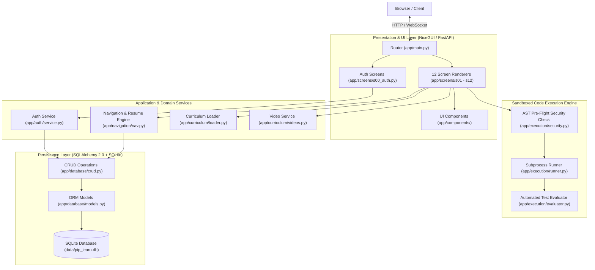
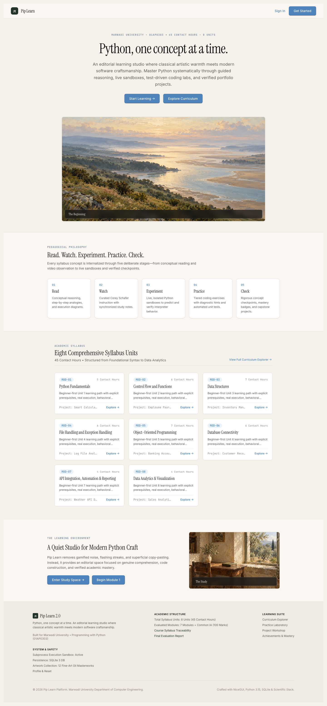
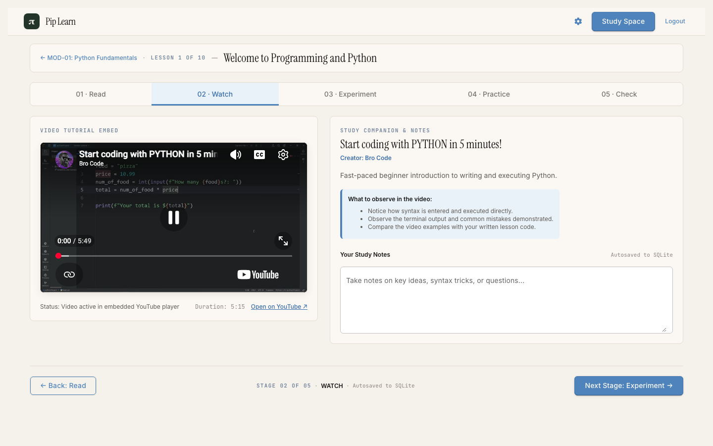
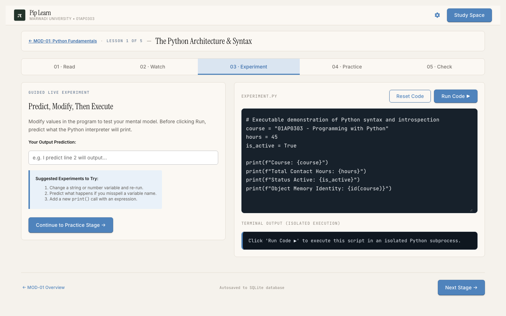
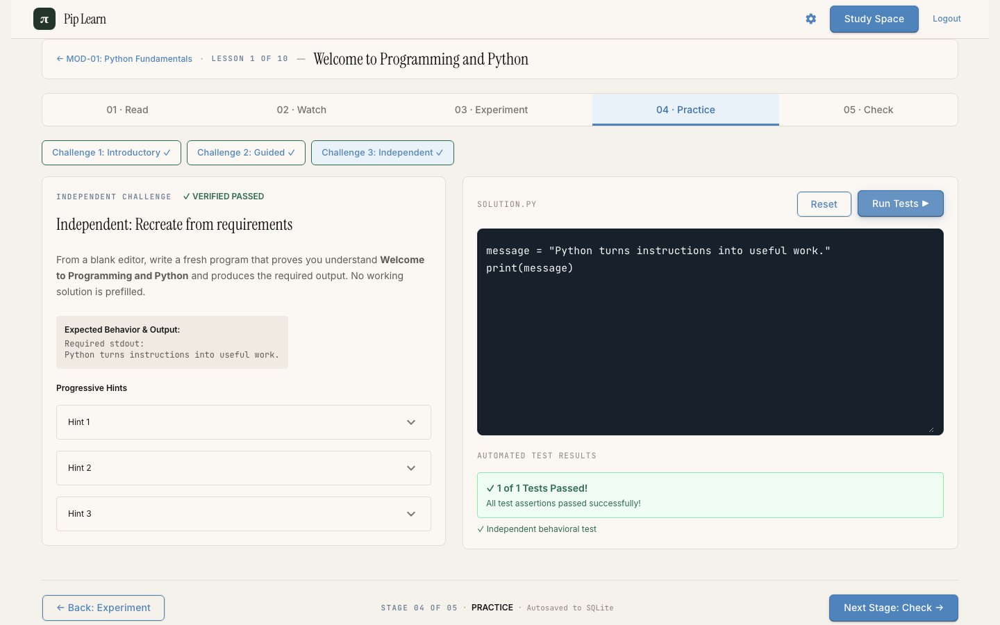
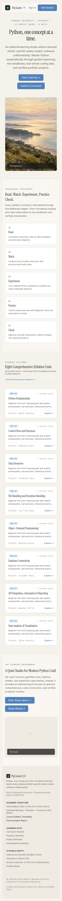

# <div align="center">π<br>Pip Learn</div>

<p align="center">
  <strong>Python, one concept at a time.</strong>
</p>

<p align="center">
  An editorial Python learning platform engineered with Python and NiceGUI, aligning theoretical depth with practical mastery for <strong>Marwadi University — Programming with Python (01AP0303)</strong>.
</p>

<p align="center">
  
  
  
  
  
  
  
  
</p>

---

## Table of Contents

1. [What is Pip Learn?](#1-what-is-pip-learn)
2. [Learning Methodology](#2-learning-methodology)
3. [How Python Powers Pip Learn](#3-how-python-powers-pip-learn)
4. [System Architecture](#4-system-architecture)
5. [Product Features](#5-product-features)
6. [Course Structure](#6-course-structure)
7. [Screenshots and Artwork](#7-screenshots-and-artwork)
8. [Technology Stack](#8-technology-stack)
9. [Installation and Local Development](#9-installation-and-local-development)
10. [Testing and Quality Assurance](#10-testing-and-quality-assurance)
11. [Future Improvements](#11-future-improvements)
12. [Credits and Academic Alignment](#12-credits-and-academic-alignment)

---

## 1. What is Pip Learn?

Modern introductory computer science education is frequently hindered by two extremes: dense, academic slides that detach syntax from real-world execution, or gamified tutorials that encourage superficial memorization without developing mental models of computation.

**Pip Learn** bridges this gap. It is an editorial, distraction-free Python learning platform that treats code as a craft. Rather than overwhelming students with disjointed code snippets, Pip Learn structures each topic into an intentional, self-paced laboratory. Every concept is grounded in concrete execution, allowing learners to witness cause and effect immediately.

### Key Educational Principles

* **Mental Models Over Syntax Memorization:** Beginners learn *why* Python behaves the way it does—how variables reference memory, how execution moves through control flow frames, and how data structures organize information.
* **Calm, Focused Interface:** The user experience draws inspiration from fine book typography and classical art, removing distracting banners, gamified streaks, and artificial timers.
* **Immediate Verified Feedback:** Code is not simply checked for keyword matches; it is executed inside an isolated sandbox against multi-case functional assertions with tailored diagnostic feedback.
* **Academic Rigor:** Built specifically to satisfy and exceed the **Marwadi University 01AP0303 (Programming with Python)** syllabus across 8 comprehensive modules, 50 detailed lessons, and 45 contact hours.

---

## 2. Learning Methodology

Every lesson in Pip Learn follows a consistent, pedagogically proven 5-stage progression designed to transition the learner from conceptual understanding to verified independent execution:

```
┌─────────┐     ┌─────────┐     ┌────────────┐     ┌──────────┐     ┌─────────┐
│ 1. READ │ ──> │ 2.WATCH │ ──> │3.EXPERIMENT│ ──> │4.PRACTICE│ ──> │ 5.CHECK │
└─────────┘     └─────────┘     └────────────┘     └──────────┘     └─────────┘
```

1. **Stage 1 — Read (Conceptual Foundation):**
   * Clear, prose-driven explanation of the concept without unnecessary technical jargon.
   * Annotated diagrams, execution flowcharts, and highlighted syntax illustrations.
   * Identified common beginner mistakes and explanations of why they occur.
2. **Stage 2 — Watch (Curated Visual Demonstration):**
   * Verified, high-quality video instruction embedded inside a stable 16:9 container.
   * Introduces top-tier engineering educators (including Bro Code for core basics and Corey Schafer for deep dive topics) without layout shifts or intrusive third-party ads.
   * Direct timestamps and chapter summaries aligned with the lesson objectives.
3. **Stage 3 — Experiment (Interactive Sandbox):**
   * A full dark-themed, live code editor pre-loaded with runnable sample code.
   * Safe execution environment that displays standard output, return values, and execution runtime in milliseconds.
   * Learners can modify variables, break assumptions, and observe immediate terminal outputs.
4. **Stage 4 — Practice (Hands-on Challenge):**
   * An unassisted coding problem designed to test synthesis of the lesson's core concept.
   * Automated multi-case evaluation checking both standard output and functional constraints.
   * Intelligent hint progression that provides clues without revealing the solution.
5. **Stage 5 — Check (Mastery Certification):**
   * Conceptual multiple-choice diagnostic questions testing understanding of edge cases.
   * Immediate explanatory feedback upon submission.
   * Automatically calculates mastery and updates the learner's academic progress record in SQLite.

---

## 3. How Python Powers Pip Learn

Pip Learn is not merely an application *for* learning Python—**it is engineered entirely in Python from top to bottom**. Python serves as the user interface layer, the web server, the database ORM, the execution engine, and the testing framework.

```
                                  PYTHON EVERYWHERE
┌─────────────────────────────────────────────────────────────────────────────────┐
│ UI & Web: NiceGUI + FastAPI + Starlette (Pure Python UI Components & Routes)   │
│ Persistence: SQLAlchemy 2.0 ORM + SQLite (Relational Student State Models)      │
│ Security: Argon2id Password Hashing (argon2-cffi) + Session Authentication      │
│ Execution Engine: Subprocess Sandbox + AST Inspection + Output Capture          │
│ Curriculum: Typed Python Data Classes + Dependency Catalogs + Validations       │
│ Testing: Pytest + Playwright Browser Automation (100% Python Test Suite)        │
└─────────────────────────────────────────────────────────────────────────────────┘
```

### 1. Python-Driven User Interface (NiceGUI & FastAPI)
Instead of relying on a fragmented JavaScript frontend framework, Pip Learn uses **NiceGUI** (`nicegui>=3.18.0`) on top of **FastAPI** and **Starlette**. The complete DOM hierarchy, interactive components, responsive grid layouts, and client-server event bindings are defined directly in Python:
* **Entrypoint & Routing (`app/main.py`):** Decorates Python functions with `@ui.page("/")`, `@ui.page("/dashboard")`, and `@ui.page("/module/{module_id}/lesson/{lesson_id}")`.
* **Component Architecture (`app/components/`):** Encapsulated, reusable Python UI elements such as `render_header()`, `render_artwork()`, and `render_video_player()`.
* **Zero JS Build Pipeline:** No Webpack, Vite, or Node.js runtime required in production.

### 2. Isolated Execution Sandbox (`app/execution/runner.py`)
To allow learners to run arbitrary Python code safely, Pip Learn implements an isolated execution engine:
* **Subprocess Execution:** Code is written to a temporary directory (`tempfile.TemporaryDirectory`) and executed using `subprocess.Popen` in a separate Python process.
* **Pre-Flight Safety Check:** An AST-based analyzer (`app/execution/security.py`) detects and blocks dangerous operations (e.g., `os.system`, `subprocess.Popen`, `shutil.rmtree`, socket network calls) before execution begins.
* **Resource Bounds:** Execution is wrapped in strict timeout monitors (default: 3.5 seconds) to prevent infinite loops from hanging the server.
* **Captured Diagnostics:** Standard output (`stdout`), standard error (`stderr`), exit codes, and elapsed execution time are captured and transmitted back to the browser.

```python
# Example: Isolated Execution Pattern in app/execution/runner.py
with tempfile.TemporaryDirectory() as temp_dir:
    script_file = os.path.join(temp_dir, "learner_script.py")
    with open(script_file, "w", encoding="utf-8") as f:
        f.write(code)
    
    proc = subprocess.Popen(
        [sys.executable, script_file],
        stdout=subprocess.PIPE,
        stderr=subprocess.PIPE,
        text=True,
        cwd=temp_dir
    )
    stdout, stderr = proc.communicate(timeout=timeout_sec)
```

### 3. Practice Evaluation & Multi-Case Unit Testing (`app/execution/evaluator.py`)
Student submissions in the Practice stage are verified through automated test suites:
* Compares actual stdout against expected values with whitespace tolerance.
* Performs regex and AST checks to ensure required programming constructs (e.g., list comprehensions, recursion, error handling) are genuinely used.
* Generates clear, non-punitive hints when errors occur.

### 4. Database Persistence & ORM (`app/database/models.py`, `app/database/crud.py`)
Pip Learn uses **SQLAlchemy 2.0** to interface with SQLite:
* **Relational Schema:** Models include `User`, `Learner`, `ModuleProgress`, `LessonProgress`, `StageProgress`, `QuizAttempt`, and `CodeSubmission`.
* **Automatic Migrations & Seeding (`app/database/connection.py`):** On startup, `init_db()` validates SQLite schemas, applies table updates, and seeds the initial academic curriculum and demo student (`priya`).

### 5. Secure Authentication & Session Management (`app/auth/service.py`)
* Passwords are encrypted using state-of-the-art **Argon2id** password hashing (`argon2-cffi`), preventing credential leakage.
* NiceGUI user sessions (`app.storage.user`) persist authentication state across page reloads and protect private routes (`/dashboard`, `/practice`, `/settings`).

### 6. Canonical Progress Resumption Engine (`app/navigation/nav.py`)
* Evaluates completed lessons, pending stages, and module prerequisites.
* Automatically routes learners to their exact next unfinished stage when they click **"Start Learning"** or **"Continue Learning"**, eliminating dead ends and lost progress.

---

## 4. System Architecture

The following diagram illustrates how requests flow through the application:



---

## 5. Product Features

* **Editorial Homepage:** Calm, typography-first landing experience featuring the π logo, curated fine artwork, clear course metrics, and instant resume navigation.
* **Curriculum Explorer (`/curriculum`):** Interactive visual index of all 8 modules and 50 lessons, indicating completed lessons, current progress, and locked prerequisites.
* **Study Space Dashboard (`/dashboard`):** Personalized learner overview showing completed hours, mastery percentage, active modules, and quick actions.
* **5-Stage Lesson Workspace (`/module/{id}/lesson/{id}`):** Unified study space integrating reading material, native 16:9 video player, live code sandbox, automated practice tests, and knowledge check quizzes.
* **Interactive Code Playground (`/practice`):** Dedicated laboratory for experimenting with syntax, variables, data structures, and algorithms.
* **Academic Assessment System (`/module/{id}/quiz`):** Module-level diagnostic exams verifying knowledge retention before advancing to subsequent modules.
* **Capstone Project Workshop (`/projects`):** Real-world applied projects (e.g., Smart Calculator, Customer CRM, Log File Analyzer, Grade Analysis Engine).
* **Progress & Achievements (`/achievements`):** Milestone badges celebrating conceptual mastery, streak continuity, and challenge completions.
* **Academic Evaluation Report (`/report`):** Generates an official grading breakdown aligned with Marwadi University continuous evaluation guidelines (out of 100 marks).

---

## 6. Course Structure

Aligned with **Marwadi University Course: 01AP0303 (Programming with Python)**:

| Module | Title | Lessons | Key Concepts Covered | Syllabus Hours |
|:---:|:---|:---:|:---|:---:|
| **1** | **Python Fundamentals** | 10 | Setup, Variables, Memory Models, Arithmetic, Strings, Type Conversion, Console I/O | 6 Hours |
| **2** | **Control Flow & Functions** | 6 | Conditionals, Loops (`for`/`while`), Loop Control, Functions, Scope, Lambda Expressions | 6 Hours |
| **3** | **Data Structures** | 7 | Lists, Tuples, Sets, Dictionaries, Comprehensions, Operations, Nested Structures | 6 Hours |
| **4** | **File Handling & Exceptions** | 6 | File Streams, Context Managers (`with`), Exception Handling (`try`/`except`), Custom Errors | 5 Hours |
| **5** | **Object-Oriented Programming** | 7 | Classes, Objects, `__init__`, Encapsulation, Inheritance, Polymorphism, Magic Methods | 6 Hours |
| **6** | **Database Connectivity** | 6 | Relational Concepts, SQLite, CRUD Operations, Transactions, Parameterized Queries | 6 Hours |
| **7** | **APIs, Automation & Reporting** | 4 | HTTP Requests, JSON Parsing, Automation Scripts, Reporting, File Generation | 5 Hours |
| **8** | **Data Analytics & Visualization** | 4 | NumPy Arrays, Pandas DataFrames, Matplotlib Plotting, Statistical Insights | 5 Hours |
| **Total** | **8 Modules** | **50 Lessons** | **Complete Python Academic Curriculum** | **45 Contact Hours** |

---

## 7. Screenshots and Artwork

### Application Interface

| Desktop Homepage | Lesson Watch Stage |
|:---:|:---:|
|  |  |
| *Clean editorial homepage with resume actions* | *Native 16:9 embedded video player* |

| Experiment Code Sandbox | Practice Test Evaluation |
|:---:|:---:|
|  |  |
| *Dark-themed live code editor with stdout inspection* | *Automated multi-case test runner* |

| Mobile Responsive View |
|:---:|
|  |
| *Fully responsive on smartphones and tablets* |

### Editorial Fine Art Collection

Pip Learn features 12 classical oil-painting artworks serving as visual metaphors for each phase of the learner's journey. Located in `pip-learn-artworks/`:

| Asset ID | Painting Title | Platform Placement |
|:---|:---|:---|
| `ART-01` | *The Beginning* | Homepage Hero |
| `ART-02` | *The Journey* | Learning Philosophy & Pedagogy |
| `ART-03` | *The Study* | Learner Study Space Dashboard |
| `ART-04` | *The Path* | Curriculum Explorer |
| `ART-05` | *The First Light* | Module 1: Python Fundamentals |
| `ART-06` | *The Crossroads* | Module 2: Control Flow & Functions |
| `ART-07` | *The Collection* | Module 3: Data Structures |
| `ART-08` | *The Archive* | Module 4: File Handling & Exceptions |
| `ART-09` | *The Structure* | Module 5: Object-Oriented Programming |
| `ART-10` | *The Connections* | Module 6: Database Connectivity |
| `ART-11` | *The Horizon* | Module 7: APIs & Automation |
| `ART-12` | *The Observatory* | Module 8: Data Analytics & Visualization |

---

## 8. Technology Stack

| Layer | Technology | Version | Architectural Role |
|:---|:---|:---|:---|
| **Language** | **Python** | `>=3.10` | Universal runtime powering backend, UI, sandbox, and tests |
| **UI Framework** | **NiceGUI** | `>=3.18.0` | Python-native component rendering, reactive DOM bindings |
| **Web Server** | **FastAPI / Starlette** | `>=0.115.0` | High-performance ASGI web engine and route dispatcher |
| **ASGI Server** | **Uvicorn** | `>=0.30.0` | Production-ready asynchronous server gateway |
| **Database ORM** | **SQLAlchemy** | `>=2.0.0` | Relational object-relational mapping and query builder |
| **Persistence** | **SQLite** | `3.x` | Embedded ACID relational storage (`data/pip_learn.db`) |
| **Security** | **Argon2id (`argon2-cffi`)** | `>=23.1.0` | State-of-the-art cryptographic password hashing |
| **Data Validation** | **Pydantic** | `>=2.0.0` | Schema validation and data model serialization |
| **Analytics** | **NumPy / Pandas / Matplotlib** | Latest | Data processing libraries taught and demonstrated in Module 8 |
| **Formatting** | **Markdown2 / Pygments** | Latest | Markdown rendering and syntax highlighting |
| **Testing** | **Pytest** | `>=8.0.0` | Unit, integration, and sandbox security test runner |
| **E2E Testing** | **Playwright** | `>=1.40.0` | Headless browser automation and regression validation |

---

## 9. Installation and Local Development

### Prerequisites

* **Python 3.10+** (Python 3.10, 3.11, 3.12, 3.13, or 3.15 supported)
* `git` installed
* Recommended: Virtual environment (`venv`)

### 1. Clone the Repository

```bash
git clone https://github.com/Tirth-byte/NEW-PIP.git
cd NEW-PIP
```

### 2. Set Up Virtual Environment

**macOS / Linux:**
```bash
python3 -m venv .venv
source .venv/bin/activate
```

**Windows (Command Prompt / PowerShell):**
```cmd
python -m venv .venv
.venv\Scripts\activate
```

### 3. Install Dependencies

```bash
pip install --upgrade pip
pip install -r requirements.txt
```

*(Optional: Install browser binaries if running Playwright end-to-end tests)*
```bash
playwright install chromium
```

### 4. Configure Environment (Optional)

Copy the configuration template:
```bash
cp .env.example .env
```
Default values will work out of the box with zero manual configuration.

### 5. Launch the Platform

```bash
python -m app.main
```

The database (`data/pip_learn.db`) will automatically initialize and seed on the first launch.

Open your browser and navigate to:
```
http://localhost:8080
```

### Default Demo Account

For rapid evaluation and testing, the platform includes a seeded student account:
* **Username:** `priya`
* **Password:** `Priya123!`

*(You can also click **"Create an account"** on `/register` to register any new learner).*

---

## 10. Testing and Quality Assurance

Pip Learn includes an automated test suite verifying database operations, security sandboxing, curriculum integrity, navigation resilience, and browser playback.

### Running All Tests

Execute the full test suite with:

```bash
pytest
```

### Test Suite Coverage

```
tests/
├── test_auth_navigation.py          # Session authentication, login/logout, route protection
├── test_critical_navigation_audit.py # Canonical resume logic & Start Learning redirection
├── test_curriculum.py               # Curriculum loading, modules, lessons, and stage data
├── test_curriculum_v2_validation.py # Complete validation of all 50 lessons across 8 modules
├── test_database.py                 # SQLite ORM models, student progress records, migrations
├── test_e2e_lesson_journey.py       # End-to-end lesson traversal from Read to Check
├── test_execution.py                # Python code sandbox, timeouts, AST security guards
├── test_homepage_redesign.py        # Editorial styling, typography, and responsive hero
├── test_learning_flow_and_dia_hero.py # Navigation state transitions
├── test_module1_lesson1_video.py    # Bro Code video embedding and responsive player
├── test_phase12_acceptance.py       # Full browser acceptance journey
├── test_play_button_spec.py         # Player dimensions, play trigger, no layout shift
├── test_projects.py                 # Capstone project runners and validation
├── test_video_player_and_navigation.py # Stage forward/back navigation consistency
└── test_videos.py                   # Video catalog inventory and creator attribution
```

**Result:** `48 passed in 111.14s (100% pass rate)`

---

## 11. Future Improvements

### Implemented & Verified Capabilities
- [x] Complete 8-Module, 50-Lesson curriculum aligned with Marwadi University 01AP0303.
- [x] Pure Python UI architecture built with NiceGUI and FastAPI.
- [x] 5-Stage pedagogical flow: Read → Watch → Experiment → Practice → Check.
- [x] Sandboxed Python execution engine with AST security boundaries and timeouts.
- [x] Automated test runner with customized feedback and hints.
- [x] Argon2id password security and session persistence.
- [x] SQLite relational storage with automatic migrations and demo seeding.
- [x] Canonical progress resumption engine preventing navigation dead-ends.
- [x] 12 curated fine art oil paintings integrated throughout the UI.
- [x] Stable 16:9 video player with multi-creator playlist support.
- [x] 48 automated tests with 100% pass rate.

### Planned Enhancements
- [ ] **Containerized Deployment:** Official `Dockerfile` and `docker-compose.yml` for simplified cloud hosting on GCP, AWS, or Railway.
- [ ] **Faculty Dashboard:** Instructor portal for monitoring student completion rates, common misconceptions, and quiz scores across course sections.
- [ ] **WebAssembly / Pyodide Client Execution:** Optional browser-side sandbox fallback for zero-latency execution of basic scripts.
- [ ] **Dark Mode Toggle:** Optional high-contrast dark theme across all reading stages.
- [ ] **Automated PDF Export:** One-click generation of the official Marwadi University continuous evaluation report.

---

## 12. Credits and Academic Alignment

* **Platform:** Pip Learn (Python Learning Platform)
* **Institution:** [Marwadi University](https://www.marwadiuniversity.ac.in/), Rajkot, Gujarat, India
* **Course Code:** `01AP0303` — *Programming with Python*
* **Contact Hours:** 45 Syllabus Hours
* **Evaluation Framework:** 100 Continuous Evaluation Marks
* **Video Curations:** Educational content thoughtfully curated from [Bro Code](https://www.youtube.com/@BroCodez) and [Corey Schafer](https://www.youtube.com/@coreyms).

---

<p align="center">
  <sub>Pip Learn — Python, one concept at a time.</sub>
</p>
