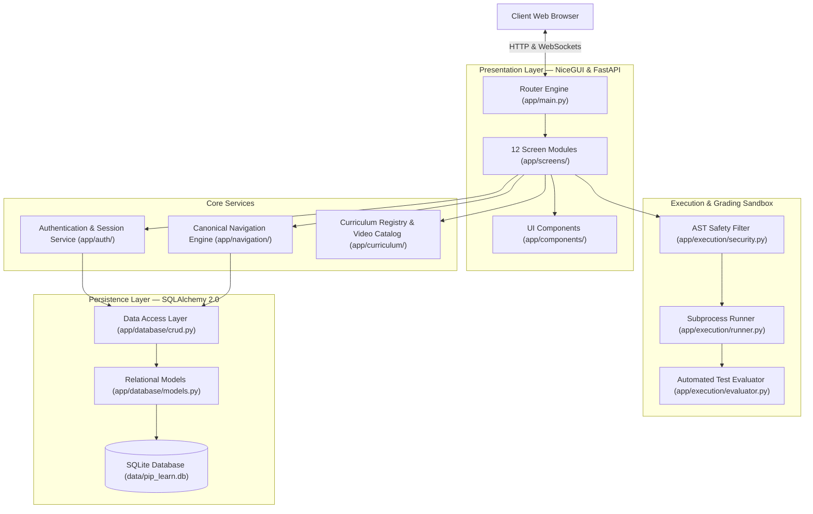

<div align="center">

# Pip Learn

<p align="center">
  <em>Python, one concept at a time.</em>
</p>

<p align="center">
  
  
  
  
  
  
</p>

<br>

<p align="center">
  
</p>

<p align="center">
  <sub><em>ART-01 — The Beginning. An editorial learning studio designed to cultivate authentic mental models of computation.</em></sub>
</p>

</div>

<br>

---

<br>

## What is Pip Learn?

Modern introductory programming courses frequently suffer from a persistent pedagogical dilemma: academic curricula often present syntax through disconnected slides and abstract notation, while online tutorials foster passive memorization through trivial code-along exercises. When confronted with unassisted problem solving, students often struggle because they lack an intuitive mental model of state, memory references, and control flow.

**Pip Learn** was created to resolve this disparity.

Engineered as a cohesive, pure-Python educational environment, Pip Learn provides an editorial, distraction-free space where software development is explored as a reasoned craft. Every lesson isolates a single concept, anchors it in clear prose, provides visual instruction, invites open experimentation in a live sandbox, validates understanding with automated multi-case tests, and solidifies retention through diagnostic checkpoints.

The curriculum is structured around the university syllabus for **Programming with Python (Course Code: 01AP0303)** at **Marwadi University**, delivering 45 contact hours across 8 foundational modules and 50 structured lessons.

<br>

---

<br>

## The Learning Experience

To transition learners from conceptual awareness to independent mastery, every lesson in Pip Learn adheres to a five-stage pedagogical progression:

<br>

<p align="center">
  
</p>

<p align="center">
  <sub><em>ART-03 — The Study. Quiet focus, deliberate practice, and continuous verified progression.</em></sub>
</p>

<br>

### 1. Read — Conceptual Foundation
Every topic begins with precise, book-grade prose. Rather than listing grammar rules in isolation, the reading stage introduces the underlying computer science rationale—explaining why a data structure behaves as it does, how Python evaluates an expression, and which common misconceptions learners typically encounter.

### 2. Watch — Curated Video Instruction
Concepts are reinforced through focused video demonstrations embedded in a stable 16:9 player with native controls and zero layout shift. The catalog features vetted master instructors—introducing core fundamentals with Bro Code and advancing into comprehensive technical explorations with Corey Schafer.

### 3. Experiment — Live Interactive Sandbox
Understanding requires testing assumptions. The experiment stage provides an integrated dark-themed code editor pre-loaded with runnable examples. Learners can modify parameters, test edge cases, and run scripts in a sandboxed runtime that reports standard output, return values, and execution duration in milliseconds.

### 4. Practice — Automated Challenge Evaluation
Independent problem solving is verified through targeted coding exercises. Learner submissions are evaluated against multi-case functional test suites that examine standard output and code structure. If a solution fails, an intelligent hint engine offers contextual diagnostics without revealing the answer.

### 5. Check — Mastery Assessment
Lessons conclude with diagnostic multiple-choice assessments designed to probe conceptual edge cases. Submissions receive immediate explanatory feedback, updating the learner's academic progress record in the persistent relational database.

<br>

---

<br>

## How Python Powers Pip Learn

Pip Learn is not merely an educational tool for learning Python; **it is an advanced software platform engineered entirely in Python**. The user interface, web framework, code sandbox, database models, session security, and automated evaluators are built using the Python ecosystem.

```
                              FULL-STACK PYTHON ARCHITECTURE
┌────────────────────────────────────────────────────────────────────────────────────────┐
│ UI & Application Layer : NiceGUI (Pure Python components, reactive bindings, Starlette) │
│ Backend Engine         : FastAPI & Uvicorn ASGI Server                                 │
│ Sandbox Execution      : Isolated Python Subprocesses + AST Pre-Flight Security Checks │
│ Curriculum Engine      : Strongly-Typed Python Data Classes & Validated Catalogs       │
│ Authentication         : Argon2id Cryptographic Password Hashing (argon2-cffi)         │
│ Persistence Layer      : SQLite Relational Database with SQLAlchemy 2.0 ORM            │
│ Quality Assurance      : Pytest & Playwright Browser Automation Suite                  │
└────────────────────────────────────────────────────────────────────────────────────────┘
```

### Python-Native UI Architecture
Pip Learn uses **NiceGUI** (`nicegui>=3.18.0`) on top of **FastAPI** and **Starlette**. The DOM structure, reactive component trees, responsive layouts, and WebSocket client-server bindings are written entirely in Python:
* **Route Declaration (`app/main.py`):** Page routes are defined via decorators (`@ui.page("/")`, `@ui.page("/dashboard")`, `@ui.page("/module/{module_id}/lesson/{lesson_id}")`).
* **Modular Screen Renderers (`app/screens/`):** 12 individual screen modules manage distinct platform domains—from authentication (`s00_auth.py`) to the lesson workspace (`s06_lesson.py`) and academic reports (`s11_report.py`).
* **Zero JavaScript Build Step:** Developers write standard Python; no node modules, bundlers, or Webpack configurations are required.

### Isolated Subprocess Code Execution
To allow users to write and execute arbitrary Python code safely, the platform incorporates a sandboxed execution engine (`app/execution/runner.py`):
* **AST Pre-Flight Safety Verification:** Before running learner scripts, an AST-based analyzer (`app/execution/security.py`) checks for unauthorized system calls (such as `os.system`, `subprocess.Popen`, `shutil.rmtree`, or raw network sockets).
* **Process Isolation:** User code runs inside isolated temporary directories (`tempfile.TemporaryDirectory`) via `subprocess.Popen`.
* **Execution Guardrails:** Strict wall-clock timeouts (default: 3.5 seconds) terminate infinite loops and prevent memory exhaustion.
* **Output Capture:** Standard output, standard error, exit codes, and millisecond elapsed execution times are parsed and relayed to the frontend.

### Automated Challenge Evaluation
Practice solutions are graded programmatically in `app/execution/evaluator.py`:
* Submissions are validated against expected outputs with whitespace normalization.
* Structural AST rules verify required programming constructs (such as list comprehensions, recursion, or explicit exception handlers).
* Non-punitive, targeted guidance is generated automatically when tests fail.

### Relational Persistence & Migration System
Learner data is managed via **SQLAlchemy 2.0** models (`app/database/models.py`) connecting to an embedded SQLite database (`data/pip_learn.db`):
* Tracks users, student records, module completions, lesson states, stage milestones, quiz scores, and project submissions.
* Automatic schema migration and seeding (`app/database/connection.py`) ensures that a newly cloned repository initializes a fully working database on first launch, including a pre-seeded demo student account (`priya`).

### Canonical Progress Resumption
The navigation engine (`app/navigation/nav.py`) dynamically computes the learner's true educational frontier. When a student clicks **"Start Learning"** or **"Continue"**, the platform queries completed stages and routes directly to the next unfinished lesson stage, avoiding broken links or hardcoded paths.

<br>

---

<br>

## System Architecture



<br>

---

<br>

## Academic Curriculum

Pip Learn implements the complete academic syllabus for **Marwadi University Course: 01AP0303 (Programming with Python)**:

1. **Module 1 — Python Fundamentals (10 Lessons):** Environment setup, variables, assignment expressions, data types, type conversion, basic arithmetic, and formatted console I/O.
2. **Module 2 — Control Flow & Functions (6 Lessons):** Relational operators, boolean logic, branching conditionals, `for` and `while` loops, functions, scope rules, and lambda expressions.
3. **Module 3 — Data Structures (7 Lessons):** Lists, tuples, sets, dictionaries, slicing operations, membership testing, dictionary methods, and list/dict comprehensions.
4. **Module 4 — File Handling & Exception Handling (6 Lessons):** Text file I/O, file access modes, context managers (`with`), exception hierarchies, `try`/`except`/`finally` blocks, and custom error types.
5. **Module 5 — Object-Oriented Programming (7 Lessons):** Classes, instances, constructors (`__init__`), instance and class methods, encapsulation, inheritance, polymorphism, and dunder methods.
6. **Module 6 — Database Connectivity (6 Lessons):** Relational database concepts, SQLite operations, SQL syntax, parameterized queries, schema creation, and database transaction handling.
7. **Module 7 — API Integration, Automation & Reporting (4 Lessons):** HTTP request handling, JSON serialization, REST API consumption, automation scripting, and automated report generation.
8. **Module 8 — Data Analytics & Visualization (4 Lessons):** NumPy array mechanics, Pandas DataFrame manipulation, statistical summaries, and data visualization using Matplotlib.

<br>

---

<br>

## Installation and Local Setup

### System Prerequisites
* **Python 3.10** or higher (tested on Python 3.10, 3.11, 3.12, 3.13, and 3.15).
* Standard `git` client.

### 1. Clone the Repository
```bash
git clone https://github.com/Tirth-byte/NEW-PIP.git
cd NEW-PIP
```

### 2. Configure the Virtual Environment

**macOS / Linux:**
```bash
python3 -m venv .venv
source .venv/bin/activate
```

**Windows (PowerShell / Command Prompt):**
```cmd
python -m venv .venv
.venv\Scripts\activate
```

### 3. Install Dependencies
```bash
pip install --upgrade pip
pip install -r requirements.txt
```

*(Optional: Install browser binaries if running Playwright end-to-end tests)*
```bash
playwright install chromium
```

### 4. Environment Configuration (Optional)
A pre-configured template is included:
```bash
cp .env.example .env
```
Default parameters allow the application to function immediately without manual adjustments.

### 5. Launch the Platform
```bash
python -m app.main
```

The SQLite database (`data/pip_learn.db`) will initialize and seed automatically.

Access the platform in any modern web browser:
```
http://localhost:8080
```

### Demo Student Account
To explore learner features immediately, use the pre-seeded account:
* **Username:** `priya`
* **Password:** `Priya123!`

*(New accounts can also be created freely via `/register`)*.

<br>

---

<br>

## Testing & Quality Assurance

The codebase includes an automated test suite verifying database integrity, security sandboxing, curriculum structure, and browser navigation.

To execute the test suite:
```bash
pytest
```

**Test Suite Coverage:**
* `tests/test_auth_navigation.py` — Session security, login/logout transitions, route access control.
* `tests/test_critical_navigation_and_progress_audit.py` — Canonical progress resumption logic.
* `tests/test_curriculum.py` & `test_curriculum_v2_validation.py` — Integrity check across all 50 lessons.
* `tests/test_database.py` — SQLite schema migrations, ORM relational integrity.
* `tests/test_execution.py` — Subprocess timeouts, AST safety rules, stdout capture.
* `tests/test_phase12_acceptance.py` & `test_play_button_spec.py` — Playwright browser automation tests.
* `tests/test_projects.py` — Capstone project execution verification.

**Status:** `48 passed (100% pass rate)`

<br>

---

<br>

## Philosophy & Future Horizons

<p align="center">
  
</p>

<p align="center">
  <sub><em>ART-12 — The Observatory. Cultivating curiosity, analytical discipline, and deep computational literacy.</em></sub>
</p>

<br>

Pip Learn is founded on the conviction that mastering computer science requires more than fast-paced tutorials or superficial syntax repetition. It demands quiet focus, rigorous experimentation, and the cultivation of an intuitive mental model. By uniting clear pedagogical writing, verified video instruction, interactive sandboxes, and classical visual art, Pip Learn offers learners a calm, intellectually serious space in which to truly learn Python.

<br>

---

<br>

## Credits and Academic Alignment

* **Platform:** Pip Learn (Python Learning Studio)
* **Academic Institution:** [Marwadi University](https://www.marwadiuniversity.ac.in/), Rajkot, Gujarat, India
* **Course:** Programming with Python (`01AP0303`)
* **Contact Hours:** 45 Syllabus Hours (100 Evaluation Marks)
* **Instructional Media:** Curated educational video instruction courtesy of [Bro Code](https://www.youtube.com/@BroCodez) and [Corey Schafer](https://www.youtube.com/@coreyms).

<br>

<div align="center">
  <sub>Pip Learn — Python, one concept at a time.</sub>
</div>
