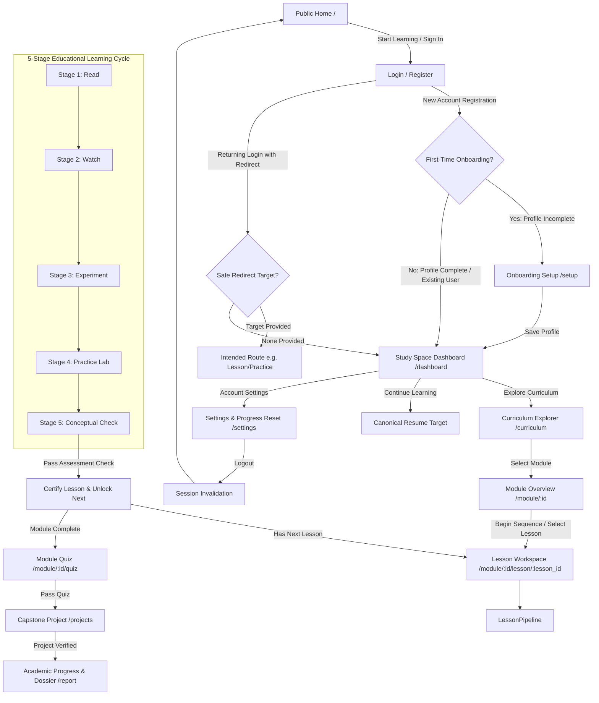

# Pip Learn — Authoritative Navigation & Application Flow Specification

**Document Version:** 2.0.0  
**Status:** Implemented & Verified  
**Date:** 2026-10-25  
**Author:** Principal Software Architect & Senior NiceGUI Engineer  

---

## 1. Architectural Overview & The Single Canonical Flow

Pip Learn enforces one unified, deterministic application pipeline across all client interactions. Unauthenticated visitors are confined to public landing pages, while all academic resources, learning telemetry, code execution sandboxes, and assessment dossiers require verified authentication.



---

## 2. Canonical Route Inventory

Every route in Pip Learn is explicitly declared with unique URI patterns, canonical parameter handling, and authentication guard enforcement.

| Route URI | Purpose | Access Control | Redirect Target When Unauthenticated | Component / Module |
| :--- | :--- | :--- | :--- | :--- |
| `/` | Public Home Landing Page | Public | N/A (Displays Sign In/Register) | `app.screens.s01_home` |
| `/login` | Account Authentication | Public / Guest | Redirects to `/dashboard` if already authenticated | `app.screens.s00_auth` |
| `/register` | Learner Account Registration | Public / Guest | Redirects to `/dashboard` if already authenticated | `app.screens.s00_auth` |
| `/logout` | Session Invalidation Endpoint | Public / Auth | Invalidate session cookie & redirect to `/` | `app.auth.service.logout_user` |
| `/setup` | First-Time Learner Onboarding | Authenticated | `/login?redirect=/setup` | `app.screens.s02_setup` |
| `/dashboard` | Study Space Learner Dashboard | Authenticated | `/login?redirect=/dashboard` | `app.screens.s03_dashboard` |
| `/curriculum` | Unified Curriculum Explorer | Authenticated | `/login?redirect=/curriculum` | `app.screens.s04_curriculum` |
| `/module/{id}` | Module Syllabus & Lesson Map | Authenticated | `/login?redirect=/module/{id}` | `app.screens.s05_module` |
| `/module/{id}/lesson/{lesson_id}` | 5-Stage Interactive Lesson Workspace | Authenticated | `/login?redirect=/module/{id}/lesson/{lesson_id}` | `app.screens.s06_lesson` |
| `/practice` | Standalone Practice Lab Workspace | Authenticated | `/login?redirect=/practice` | `app.screens.s07_practice` |
| `/module/{id}/quiz` | Module Assessment & Graded Check | Authenticated | `/login?redirect=/module/{id}/quiz` | `app.screens.s08_quiz` |
| `/projects` | Capstone Projects & Portfolio | Authenticated | `/login?redirect=/projects` | `app.screens.s09_project` |
| `/achievements` | Academic Honors & Milestones | Authenticated | `/login?redirect=/achievements` | `app.screens.s10_achievements` |
| `/report` | Academic Dossier & Performance Report | Authenticated | `/login?redirect=/report` | `app.screens.s11_report` |
| `/settings` | Account Settings & Progress Reset | Authenticated | `/login?redirect=/settings` | `app.screens.s12_settings` |

---

## 3. Centralized Navigation Service (`app.navigation.nav`)

All UI buttons, links, cards, and redirections interact exclusively through `app.navigation.nav`. Inline `ui.navigate.to(...)` calls with ad-hoc hardcoded URL strings have been eradicated.

### Canonical Navigation Actions

```python
# app/navigation/nav.py

def go_to_home() -> None:
    """Navigate to public home landing."""

def go_to_login(redirect_target: Optional[str] = None) -> None:
    """Navigate to login page, preserving safe internal redirect parameter."""

def go_to_register() -> None:
    """Navigate to registration page."""

def go_to_setup() -> None:
    """Navigate to onboarding setup."""

def go_to_dashboard() -> None:
    """Navigate to authenticated Study Space dashboard."""

def go_to_curriculum() -> None:
    """Navigate to unified curriculum explorer."""

def open_module(module_id: int) -> None:
    """Open syllabus details for the specified module ID."""

def open_lesson(module_id: int, lesson_id: str, stage: Optional[str] = None) -> None:
    """Open canonical lesson workspace, preserving active stage parameter."""

def resume_learning(learner_id: int) -> None:
    """Calculate deterministic resume target and navigate immediately."""

def logout() -> None:
    """Invalidate server session, clear client state, and redirect to home."""
```

---

## 4. Authentication Guard Architecture

Authentication guards are enforced server-side before any screen renders.

### Safe Redirect Preservation & Open-Redirect Immunity

When an unauthenticated request reaches any protected route:
1. `require_auth(db, active_route=...)` checks the incoming request's session cookie.
2. If invalid or missing, it sanitizes the target URL:
   - Validates that the URL starts with `/` and not `//` or `http://` / `https://`.
   - Rejects any external, protocol-relative, or malformed redirects.
   - Preserves query parameters like `?stage=experiment`.
3. Calls `ui.navigate.to(f"/login?redirect={quote(clean_target)}")`.
4. After successful credentials verification at `/login`, the learner is seamlessly returned to `clean_target`. If no redirect is specified, default is `/dashboard`.

---

## 5. UI Controls & Button Behavior Matrix

| Source Component | UI Control Name | Click Handler | Unauthenticated Behavior | Authenticated Behavior |
| :--- | :--- | :--- | :--- | :--- |
| **Global Header** | Logo Monogram `π Pip Learn` | `nav.go_to_home` | Navigates to `/` | Navigates to `/` |
| **Global Header** | Navigation Links (`Curriculum`, `Dashboard`, etc.) | Direct Links | Redirected to `/login?redirect=...` | Direct access to requested workspace |
| **Global Header** | Sign In / Register Buttons | `nav.go_to_login` / `nav.go_to_register` | Opens Login / Registration modal | Rendered as User Dropdown + Logout |
| **Global Header** | Logout Button | `nav.logout` | Not visible | Invalidates session, redirects to `/` |
| **Home Hero** | Start Learning CTA | `nav.start_learning(learner_id)` | Redirects to `/login` | Deterministic resume target |
| **Home Hero** | Explore Curriculum CTA | `nav.go_to_curriculum` | Redirects to `/login?redirect=/curriculum` | Opens `/curriculum` |
| **Home Syllabus** | Module Cards (8) | `nav.open_module(m_id)` | Redirects to `/login?redirect=/module/:id` | Opens `/module/:id` |
| **Dashboard** | Continue Learning Button | `nav.resume_learning(learner_id)` | N/A (Guarded page) | Resolves latest active lesson and stage |
| **Dashboard** | Curriculum Explorer Button | `nav.go_to_curriculum` | N/A (Guarded page) | Opens `/curriculum` |
| **Curriculum** | Module Explore Buttons | `nav.open_module(m_id)` | N/A (Guarded page) | Opens `/module/:id` |
| **Curriculum** | Module Direct Lesson CTA | `nav.open_lesson(m_id, l_id, "read")` | N/A (Guarded page) | Opens first or next incomplete lesson |
| **Lesson Workspace** | Next Lesson Button | `nav.open_lesson(m_id, next_id, "read")` | N/A (Guarded page) | Transitions to next lesson in syllabus |
| **Lesson Workspace** | End of Module Quiz CTA | `nav.open_quiz(m_id)` | N/A (Guarded page) | Navigates to module assessment |
| **Settings** | Reset Course Progress | Explicit modal confirmation | N/A (Guarded page) | Clears completions and activities; resets to M1-L1 Read |

---

## 6. Lesson Workspace Single Navigation Architecture

To eliminate duplicate forward buttons and prevent learner confusion, the Lesson Workspace enforces exactly **one primary forward action per stage**, anchored in the sticky/bottom footer bar (`.lesson-nav-footer`):

```
+---------------------------------------------------------------------------------------------------------+
| [← Back: Read]          STAGE 02 OF 05 · WATCH · Autosaved to SQLite          [Next Stage: Experiment →]|
+---------------------------------------------------------------------------------------------------------+
```

### Stage Footer Triad Contract
1. **Left Action (Back / Previous):**
   - Stage 1 (Read): Returns to module overview (`← MOD-01 Overview`) or previous lesson if available.
   - Stages 2–5: Explicit outlined button returning to the preceding stage (`← Back: Read`, `← Back: Watch`, `← Back: Experiment`, `← Back: Practice`).
2. **Center Element (Progress & Status):**
   - Displays current stage index and title: `STAGE 0X OF 05 · STAGE NAME`.
   - Displays real-time database persistence state: `· Autosaved to SQLite`.
3. **Right Action (Forward / Next):**
   - Advances sequentially: `Read` → `Watch` → `Experiment` → `Practice` → `Check`.
   - On `Check` stage: Locked (`opacity-50 cursor-not-allowed`) until all check questions are correctly verified; once certified, displays `Next Lesson →` (or `Module Assessment & Quiz →` on final lesson).
   - Duplicate forward buttons inside stage panels (e.g., redundant `"Continue to Experiment Stage"` inside study notes panel, inline next buttons in Experiment/Practice) have been completely removed.
   - Study notes and code activities autosave asynchronously without requiring navigation button clicks.

---

## 7. Layout-Stable 16:9 Video Player Architecture

The Watch stage incorporates a strictly stable, zero-layout-shift video viewing architecture:

1. **Fixed Aspect Ratio & CSS Containment:**
   - Container has `aspect-ratio: 16 / 9;`, `position: relative;`, `contain: layout size;`, `box-sizing: border-box;`, and `#0b0c0e` background.
   - Container maintains sub-pixel identical dimensions and bounding box coordinates (`x`, `y`, `width`, `height`) before playback, during active streaming, when paused, and upon completion.
2. **Zero-Rebuild Poster Layer Swap:**
   - Poster layer contains honest video thumbnail and centered Play button.
   - Upon clicking Play, the poster layer is hidden and the YouTube iframe (`controls=1&playsinline=1&enablejsapi=1`) is revealed within the same container.
   - The outer page DOM is never rebuilt, eliminating layout shifts and screen flicker.
3. **Native Controls & Fullscreen:**
   - Custom playback controls (scrubbers, play/pause buttons, volume sliders) are prohibited; standard YouTube native controls and native fullscreen API are preserved.
4. **Independent Study Notes & Persistence:**
   - Notes editor operates on an isolated debounce handler with an inline status indicator (`✓ Notes saved`), completely decoupled from the video iframe DOM.
   - Switching away from the Watch stage automatically pauses the YouTube video via `postMessage({"event":"command","func":"pauseVideo","args":""})`. Returning to the Watch stage preserves state without unintended autoplay.

