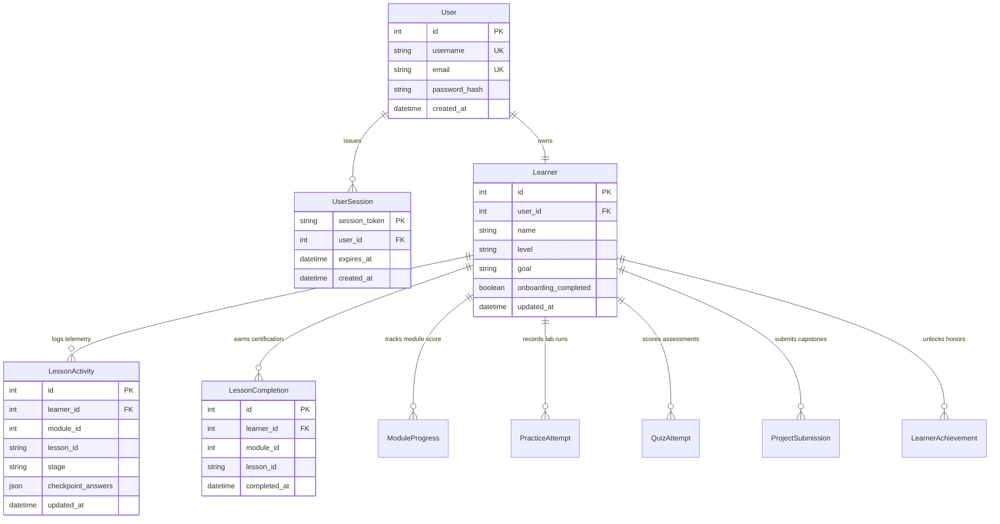

# Pip Learn — Authoritative Learner Progress Model & Telemetry Specification

**Document Version:** 2.0.0  
**Status:** Implemented & Verified  
**Date:** 2026-10-25  
**Author:** Principal Software Architect & Senior NiceGUI Engineer  

---

## 1. Single Source of Truth Architecture

Pip Learn replaces scattered, client-side, and hardcoded learner state with one unified relational schema persisted in SQLite (`data/pip_learn.db`). All telemetry, stage completions, quiz attempts, practice evaluations, and certifications are tied strictly to an authenticated learner account.



---

## 2. Separation of Learning Telemetry vs. Lesson Mastery

A critical defect identified in legacy versions was confusing browsing activity or code execution with conceptual mastery. Pip Learn establishes unambiguous boundaries:

1. **Lesson Telemetry (`LessonActivity`):**
   - Captures stage presence (`read`, `watch`, `experiment`, `practice`, `check`).
   - Persists code drafts in the experiment sandbox.
   - Saves intermediate answers to checkpoint mini-quizzes.
   - **Does NOT increment completed lesson counters.**
   - Enables resuming exactly where the learner paused.

2. **Lesson Mastery (`LessonCompletion`):**
   - Requires verified, 100% correct completion of all conceptual check questions in Stage 5 ("Check").
   - Triggers `mark_lesson_complete()`, creating an immutable `LessonCompletion` record.
   - Automatically unlocks academic honors (e.g., `FIRST_STEP`).
   - Increments the completed lesson count in telemetry calculations.

3. **Practice Evaluation (`PracticeAttempt`):**
   - Logs every AST-checked and execution-validated practice exercise.
   - Evaluates test case assertions against stdout and runtime environment.
   - Does NOT count executions as passed exercises unless all test assertions pass.

4. **Module Assessment (`QuizAttempt`):**
   - Evaluates randomized module quiz submissions.
   - Requires score $\ge 70.0\%$ for passing grade.
   - Contributes 25% to overall module completion weight.

5. **Capstone Project (`ProjectSubmission`):**
   - Validates multi-step project deliverables against rigorous architectural rubrics.
   - Contributes 25% to overall module completion weight.

---

## 3. Mathematical Formulas for Progress Calculation

All progress bars, percentage indicators, and academic dossiers use the authoritative `get_learner_summary()` formula:

### 3.1 Module Completion Formula

For any module $m$ with $N_m$ total lessons:

$$\text{Lesson Ratio} = \frac{\text{Completed Lessons in } m}{N_m}$$

$$\text{Quiz Ratio} = \begin{cases} 1.0 & \text{if best quiz score in } m \ge 70.0\% \\ \frac{\text{Best Quiz Score}}{100.0} & \text{otherwise} \end{cases}$$

$$\text{Project Ratio} = \begin{cases} 1.0 & \text{if approved capstone project exists for } m \\ 0.0 & \text{otherwise} \end{cases}$$

$$\text{Module Progress } P_m = (0.50 \times \text{Lesson Ratio} + 0.25 \times \text{Quiz Ratio} + 0.25 \times \text{Project Ratio}) \times 100\%$$

### 3.2 Overall Course Progress Formula

For the 8 accredited modules:

$$\text{Overall Course Progress} = \frac{1}{8} \sum_{m=1}^{8} P_m$$

---

## 4. Deterministic Resume Resolution Algorithm

When a learner clicks "Continue Learning" on the Study Space Dashboard, or "Start Learning" on the Homepage as an authenticated user, `nav.resolve_resume_target(learner_id)` calculates the next canonical destination:

```python
def resolve_resume_target(learner_id: int) -> Tuple[int, str, str]:
    """
    1. Query all completed lesson IDs for this learner.
    2. Query the latest LessonActivity record ordered by updated_at DESC.
    
    Case A: Active lesson is incomplete:
        Return (active.module_id, active.lesson_id, active.stage)
        
    Case B: Active lesson is completed (or no active record):
        Iterate curriculum in canonical order (Modules 1..8, Lessons 1..N):
        Find the first lesson not present in completed lesson IDs.
        Return (module.id, next_lesson.id, "read")
        
    Case C: All lessons completed across the entire curriculum:
        Return (8, last_lesson.id, "check") -> Course Completion Summary
    """
```

### Deterministic State Matrix

| Learner State | Historical Record | Resume Resolution Result |
| :--- | :--- | :--- |
| **Fresh Account** | No completions, no activities | Module 1, Lesson 1, Stage: `read` |
| **Reading Lesson 1** | Activity: `m1-l1`, Stage: `read` | Module 1, Lesson 1, Stage: `read` |
| **Testing in Sandbox** | Activity: `m1-l1`, Stage: `experiment` | Module 1, Lesson 1, Stage: `experiment` |
| **Completed Lesson 1** | Completion: `m1-l1` | Module 1, Lesson 2, Stage: `read` |
| **Completed Module 1** | Completions: `m1-l1` .. `m1-l5` | Module 2, Lesson 1, Stage: `read` |
| **100% Course Complete**| All 28 syllabus lessons certified | Module 8, Final Lesson, Stage: `check` |

---

## 5. Multi-Tenancy & Data Isolation Guarantees

1. **Foreign Key Integrity:**
   All tables (`learners`, `lesson_completions`, `lesson_activities`, `practice_attempts`, `quiz_attempts`, `project_submissions`, `learner_achievements`) reference `learner_id` with `ON DELETE CASCADE`.

2. **Session-Bound Identity:**
   Every API, route, and database transaction resolves `user_id` strictly from the cryptographically random session token extracted from NiceGUI's server session cookie. The client is never permitted to specify or override its `learner_id`.

3. **Progress Reset Safety:**
   Resetting course progress (`reset_learner_course_progress`) requires an explicit two-step confirmation dialog. Destructive deletions are isolated exclusively to the caller's `learner_id`, leaving other learners' records completely untouched.
